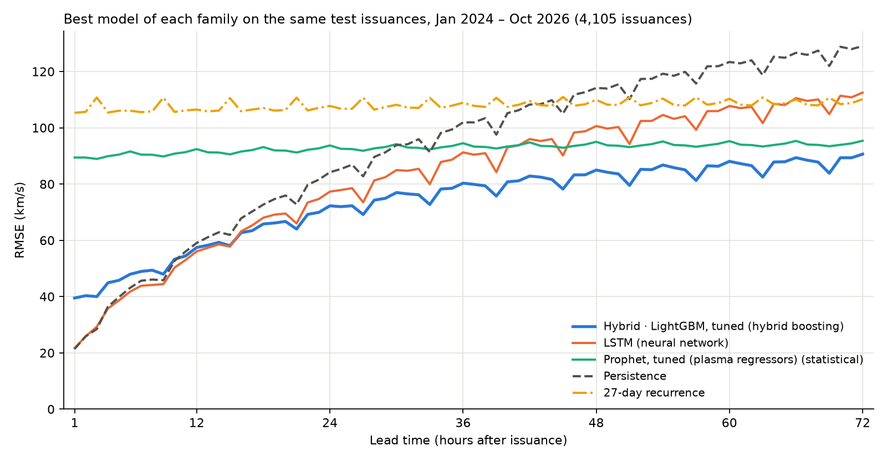

# Solar Wind Forecasting · FDL BenchLab 2026

Hourly forecasts of the solar-wind speed measured by ACE at L1, 1 to 72 hours ahead.
This is our entry to the
[FDL BenchLab Solar Wind Prediction Tournament 2026](overvie.md). Every 6 hours the
organizers run a stateless Docker container on CPU with a 15-minute limit; the official
metric is TIMSE.

The best model is a **gradient-boosting hybrid**: a single model for all 72 lead hours
that combines three sources of information, all cut off at `t0 − 1 h`:

- **L1 plasma (ACE):** latest speed and its age; 6, 24 and 72 h means; trend, density
  and temperature;
- **27-day recurrence:** speed one and two solar rotations before each target hour;
- **coronal holes (SDO/AIA 193 Å):** dark-area fraction in six 15° longitude strips, in
  images taken 0, 24 and 48 h earlier.


## Benchmark

Every model was scored on the **same 4,105 issuances** of the hybrid test period
(Jan 2024 – Oct 2026, one every 6 h), against the same observed hourly speed, on the
221,818 forecast hours where the observation exists. No model saw this period during
training or selection.

| Model | Family | Trained on | RMSE (km/s) | 1–24 h | 25–48 h | 49–72 h | Skill vs persistence | TIMSE pooled (M) | TIMSE median per issuance (k) |
| --- | --- | --- | ---: | ---: | ---: | ---: | ---: | ---: | ---: |
| **Submission · tuned LightGBM + persistence blend** | Hybrid boosting | 2011–2021 | **74.4** | 53.7 | 78.5 | 87.0 | +23.9% | 70.6 | 326 |
| Hybrid · LightGBM, tuned | Hybrid boosting | 2011–2021 | 75.3 | 57.3 | 78.7 | 86.7 | +23.1% | 74.6 | 358 |
| Hybrid · XGBoost | Hybrid boosting | 2011–2021 | 75.7 | 56.7 | 79.5 | 87.6 | +22.6% | 72.2 | 369 |
| Hybrid · scikit-learn HGB | Hybrid boosting | 2011–2021 | 76.0 | 57.0 | 79.7 | 87.9 | +22.3% | 74.4 | 375 |
| Hybrid · LightGBM | Hybrid boosting | 2011–2021 | 76.3 | 56.9 | 80.1 | 88.4 | +22.0% | 75.2 | 372 |
| Hybrid · CatBoost | Hybrid boosting | 2011–2021 | 76.4 | 57.7 | 79.9 | 88.3 | +21.9% | 72.2 | 380 |
| Hybrid · NGBoost | Hybrid boosting | 2011–2021 | 77.5 | 57.7 | 81.2 | 90.0 | +20.7% | 77.4 | 386 |
| Patch Transformer | Neural network | 2011–2021 | 78.4 | 55.1 | 81.9 | 93.3 | +19.9% | 71.5 | 325 |
| Hybrid · LightGBM, tuned, no coronal holes | Hybrid boosting | 2011–2021 | 78.6 | 58.0 | 82.4 | 91.7 | +19.6% | 81.7 | 343 |
| GRU | Neural network | 2011–2021 | 80.2 | 53.5 | 83.3 | 97.3 | +18.1% | 74.8 | 315 |
| LSTM | Neural network | 2011–2021 | 80.7 | 53.9 | 83.9 | 98.0 | +17.5% | 75.5 | 318 |
| Transformer | Neural network | 2011–2021 | 81.3 | 55.8 | 84.7 | 97.7 | +16.9% | 76.6 | 326 |
| GRU with attention | Neural network | 2011–2021 | 83.0 | 57.2 | 86.0 | 100.0 | +15.2% | 80.1 | 370 |
| LSTM with attention | Neural network | 2011–2021 | 84.0 | 57.8 | 87.0 | 101.2 | +14.2% | 76.2 | 378 |
| Prophet, tuned (plasma regressors) | Statistical | 180 days before each issuance | 93.0 | 91.3 | 93.4 | 94.2 | +5.0% | 74.2 | 712 |
| Prophet | Statistical | 180 days before each issuance | 96.8 | 96.5 | 96.9 | 97.1 | +1.0% | 105.9 | 640 |
| Persistence | Baseline | — | 97.8 | 60.2 | 100.8 | 122.2 | +0.0% | 64.0 | 556 |
| 27-day recurrence | Baseline | — | 107.8 | 106.5 | 108.0 | 108.8 | -10.2% | 59.9 | 928 |
| Hybrid · XGBoost, TIMSE weights | Hybrid boosting | 2011–2021 | 108.8 | 90.7 | 112.6 | 120.9 | -11.2% | 49.2 | 729 |

Lead-time columns are RMSE in km/s. Skill is the RMSE reduction against persistence.



- The submitted forecast (tuned LightGBM hybrid blended with persistence) has the lowest
  RMSE, 74.4 km/s: 24% below persistence. The blend mostly helps the first day
  (57.3 → 53.7 km/s over 1–24 h).
- The neural networks retrained on the hybrid's splits are close in the first day: the
  GRU (53.5 km/s) matches the submission over 1–24 h. They fall behind at long leads
  (93–101 km/s at 49–72 h, against 87), where the coronal-hole features matter. The
  Patch Transformer, whose 30-day input reaches the 27-day recurrence, is the best
  network (78.4 km/s).
- All five boosting libraries land within 2 km/s of each other. The coronal-hole
  features are worth 3.4 km/s overall (95% CI 1.4–5.5) and 5.5 km/s at 72 h.
- Prophet is flat across leads: weak early, close to the networks at 49–72 h.
- **A caveat on TIMSE:** pooled over the whole period, it rewards forecasts biased
  upwards. That is why the TIMSE-weighted hybrid has the best pooled TIMSE with the worst
  RMSE, and why a constant 700 km/s (42.1 M) beats every model. Scored per issuance (last
  column), the bias stops paying. How the organizers aggregate TIMSE is still to be
  confirmed.

How to read the comparison:

- **Same training period.** Hybrids and networks were trained on 2011–2021 and selected
  on 2022 to 2023. The networks' validation stops on 9 Nov 2023, because their code
  refuses to skip the issuance left without data by an ACE gap on 10 Nov 2023
  (`scripts/slurm/train_networks.sbatch`). Their hyperparameters are those of the
  earlier 2019 experiments and were not tuned again.
- **Inputs.** Neural networks and Prophet read the real-time ACE product, as they would
  in operations. The hybrids read Level 2 where available (until July 2024) and the
  real-time product afterwards. Using the real-time product alone changes the hybrid's
  RMSE from 76.0 to 76.2 km/s.
- Prophet is refit at every issuance on the previous 180 days, with the configuration
  selected in [docs/tuning.md](docs/tuning.md).

<details>
<summary>Earlier network checkpoints, trained on 2019 or 2003–2009 only</summary>

| Model | Family | Trained on | RMSE (km/s) | 1–24 h | 25–48 h | 49–72 h | Skill vs persistence | TIMSE pooled (M) | TIMSE median per issuance (k) |
| --- | --- | --- | ---: | ---: | ---: | ---: | ---: | ---: | ---: |
| LSTM | Neural network | 2019 | 86.5 | 56.2 | 89.5 | 106.2 | +11.6% | 73.8 | 384 |
| GRU | Neural network | 2019 | 86.6 | 55.7 | 89.3 | 106.8 | +11.5% | 73.5 | 392 |
| Transformer | Neural network | 2003–2009 | 88.3 | 60.6 | 90.7 | 107.3 | +9.7% | 62.6 | 445 |
| Transformer | Neural network | 2019 | 89.1 | 62.4 | 90.8 | 108.1 | +8.9% | 78.6 | 506 |
| Patch Transformer | Neural network | 2019 | 91.6 | 70.7 | 93.0 | 107.3 | +6.4% | 77.4 | 526 |
| GRU with attention | Neural network | 2003–2009 | 96.9 | 71.0 | 99.8 | 114.8 | +0.9% | 64.0 | 552 |
| GRU with attention | Neural network | 2019 | 104.8 | 78.6 | 109.3 | 121.9 | -7.2% | 85.9 | 953 |
| LSTM with attention | Neural network | 2019 | 105.4 | 79.8 | 108.3 | 123.4 | -7.7% | 92.1 | 953 |
| Patch Transformer | Neural network | 2003–2009 | 106.3 | 80.9 | 109.7 | 123.8 | -8.7% | 50.1 | 695 |

With less training data they are 6 to 28 km/s worse than the same architectures
retrained on 2011–2021.

</details>

To reproduce, run `scripts/benchmark_all_models.py` (about 10 min on 8 cores) and then
`scripts/plot_benchmark.py`. Results go to `data/experiments/benchmark_2024_2026/`.
Details of the hybrid are in [docs/hybrid.md](docs/hybrid.md); the results deck is
[docs/presentation/benchlab_results.pptx](docs/presentation/benchlab_results.pptx).

## Repository layout

```
src/benchlab_forecasting/  package: data, features, models, validation and TIMSE
  hybrid.py                hybrid model (experiment and tune)
  coronal_holes.py         coronal-hole mask and fractions from AIA images
  validation.py            metrics, TIMSE and block bootstrap
scripts/                   data download, feature building and figures
scripts/slurm/             SLURM jobs for training and hyperparameter search
tests/                     unit tests (unittest)
notebooks/                 exploration of the ACE data and AIA images
docs/                      documentation of each model and experiment (in Portuguese)
docs/presentation/         results deck, figures and the scripts that build them
overvie.md                 tournament summary, rules and plan (in Portuguese)
```

`data/` is not versioned (about 96 GB). Everything in it is rebuilt by the scripts below.

## Installation

Requires Python 3.11 or newer (the project uses 3.14, see `.python-version`) and
[uv](https://docs.astral.sh/uv/).

```bash
git clone git@github.com:AdrianoPereira/solar-wind-forecasting.git
cd solar-wind-forecasting
uv sync --locked --extra hybrid --extra boosting --group images --group notebooks
```

| Extra or group | Purpose |
| --- | --- |
| `--extra hybrid` | hybrid model with scikit-learn |
| `--extra boosting` | LightGBM, XGBoost, CatBoost and NGBoost |
| `--group images` | reading AIA FITS images (astropy) |
| `--group notebooks` | Jupyter, matplotlib and scipy (figures) |
| `--extra forecast` | Prophet |
| `--extra lstm` / `--extra hpo` | LSTM, GRU and Transformers on CPU (PyTorch); Optuna |

To add more extras later without removing installed packages, use
`uv sync --locked --inexact ...`.

## Running the hybrid model

Run every command from the repository root.

**1. Download the data** (ACE Level 2 and real-time, and AIA 193 Å every 6 h since 2011).
The download resumes where it stopped and takes hours:

```bash
mkdir -p data/download_logs
nohup bash scripts/download_training_data.sh > data/download_logs/latest.out 2>&1 &
```

Optional variables (`START_YEAR`, `END_DATE`, `AIA_JOBS`, `SKIP_AIA=1`…) are listed in
the script header. Individual downloads are described in
[scripts/README.md](scripts/README.md).

**2. Build the features:**

```bash
.venv/bin/python scripts/build_coronal_hole_features.py --workers 16   # data/features/coronal_holes_0193_6h.parquet
.venv/bin/python scripts/build_speed_series.py                          # speed series used by the figures
```

**3. Train and evaluate.** Each command trains the chosen variants, selects the number
of trees on validation (2022–2023) and scores the test period once:

```bash
export OMP_NUM_THREADS=16
# scikit-learn (default): MSE, MSE without coronal holes, and TIMSE-weighted variants
.venv/bin/python -m benchlab_forecasting.hybrid experiment \
  --variants mse mse_no_ch timse --output-dir data/experiments/hybrid_2011_2026
# another library: --model lightgbm | xgboost | catboost | ngboost
.venv/bin/python -m benchlab_forecasting.hybrid experiment --model xgboost \
  --variants mse mse_no_ch timse --output-dir data/experiments/hybrid_xgboost_2011_2026
```

Each experiment writes `report.json` (metrics and confidence intervals),
`test_predictions.parquet` and the fitted models (`model_*.pkl`).

**4. Hyperparameter search** (40 trials, resumable). It produces the tuned LightGBM in
`data/experiments/hybrid_lightgbm_tuning/`:

```bash
.venv/bin/python -m benchlab_forecasting.hybrid tune --model lightgbm --trials 40 --threads 32 \
  --output-dir data/experiments/hybrid_lightgbm_tuning
```

**5. Benchmark of all models** on the same test issuances (needs the `lstm` and `forecast`
extras):

```bash
OMP_NUM_THREADS=1 .venv/bin/python scripts/benchmark_all_models.py --workers 8
.venv/bin/python scripts/plot_benchmark.py
```

**6. Figures and deck:**

```bash
.venv/bin/python docs/presentation/make_figures.py   # deck figures, in docs/presentation/figures/
```

The `.pptx` is built by `docs/presentation/build.js` with `pptxgenjs`. To rebuild it:

1. Run `npm install` in `docs/presentation/`.
2. Run `node build.js`, with `PPTX_SKILL` pointing to a folder that contains
   `scripts/apply_theme.js`. That script applies the theme colors and is not part of
   this repository.

### On a SLURM cluster (SDumont)

Login nodes kill any process after 30 minutes of CPU time. Without `OMP_NUM_THREADS`,
the libraries open one thread per core and the process is killed. Run long training
jobs through SLURM, and set your account and partition in the `.sbatch` files.

```bash
mkdir -p data/slurm_logs
MODEL=catboost sbatch scripts/slurm/hybrid_experiment.sbatch   # VARIANTS, MAX_ITER and OUTPUT_DIR are optional
sbatch scripts/slurm/tune_lightgbm.sbatch
```

## Tests

```bash
OMP_NUM_THREADS=2 PYTHONPATH=src .venv/bin/python -m unittest discover -s tests
```

Some tests need the optional extras (`boosting`, `lstm`, `forecast`); the rest run with
`hybrid` alone.

## Other models

Before the hybrid we tried Prophet, LSTM, GRU, attention models and Transformers (see the
benchmark above). Documentation for each (in Portuguese):

- [Prophet and baselines](docs/forecasting.md), [Prophet tuning](docs/tuning.md) and
  [Prophet on complete windows](docs/prophet_complete_windows.md); CLI `benchlab-forecast`
  (`uv sync --locked --extra forecast`).
- [LSTM](docs/lstm.md), [GRU](docs/gru.md), [GRU with attention](docs/attention_gru.md),
  [GRU with attention tuning](docs/attention_gru_tuning.md) and
  [LSTM with attention, Transformer and Patch Transformer](docs/attention_models.md).
- [Temporal validation](docs/validation.md), [TIMSE with figures](docs/timse.md) and
  [result plots](docs/plotting.md).
- [Two linked SOMs as post-processing](docs/som.md): one map learns the shapes of the last
  72 h of solar wind, another the shapes of the next 72 h, and their link adjusts the
  model's forecast. This brought no gain on the test (+0.03 km/s, 95% CI −0.07 to +0.14),
  because the past speed carries only ~6% of the information about the future shape.
  Scenarios built from real training series instead of averages raise the peaks a little
  but cost RMSE. As an ensemble they lose to the model plus real validation errors (CRPS
  47.6 vs 38.2). Adding the coronal holes and the speed level to the input map doesn't
  change this: the booster already uses that information better.

### TIMSE-oriented forecast

The ranking metric is TIMSE, and the submitted forecast is tuned for RMSE.
[docs/timse_blend.md](docs/timse_blend.md) blends it with a LightGBM trained on TIMSE
weights, plus a constant offset. The blend is chosen on 2022–2023 to be robust to how TIMSE
is aggregated (pooled, 90-day windows, per month, per issuance). On the test period, the
robust blend lowers TIMSE by 32–49% under every pooled or mean aggregation, but nearly
triples it if TIMSE is the median per issuance, and RMSE rises from 74 to 118 km/s. Which
version to submit depends on the official aggregation.

### Future work

- [Physics-informed model](docs/physics_informed_model.md) (proposal, not implemented). It
  would map coronal-hole areas to a solar-source speed and propagate it to L1 with a
  differentiable HUX solver, then use the result as an extra feature for the booster. The
  page explains why this beats a plain PINN here, and gives the expected gain (1–3 km/s at
  long leads) and the criteria for adopting it.

## Tournament submission

`submission/` holds the Benchlab container: the tuned LightGBM hybrid blended with
persistence (per-lead weights chosen on 2022–2023: 0.91 at 1 h, 0.22 at 24 h, 0.07 at
72 h). It reaches a test RMSE of 74.4 km/s, against 75.3 for the hybrid alone; most of the
gain is in the first 12 hours (48.2 → 41.3 km/s).

At each run, `forecast.py` downloads only data available at `t0`:

- ACE hourly plasma from NOAA SWPC, with the latest hours completed from the 1-minute file;
- three SDO/AIA 193 Å images from the JSOC near-real-time folder.

It builds the features with the same `build_pairs` used in training and uploads 72
values. Without AIA images it switches to the model without coronal holes. Details are in
[submission/README.md](submission/README.md).

```bash
.venv/bin/python scripts/export_submission_model.py   # boosters, feature order and blend weights -> submission/model/
bash submission/build.sh                               # package and zip -> submission/dist/submission.zip
.venv/bin/python submission/forecast.py 20261111T060000Z   # run one forecast without Docker (PYTHONPATH=src)
```

Checks done before submitting:

- Replaying past issuances live gives the same features as the archive: coronal-hole
  fractions within 0.001, and forecasts within 1–12 km/s of the offline test predictions.
- `run.sh` and `upload.sh` pass the starter kit's mock upload in a clean Python 3.14
  environment with only `requirements.txt`, in about 25 s.
- The Docker image itself was not built locally (no rootless Docker on the cluster). Its
  first build happens in the Benchlab pre-deployment dry run.

The official starter kit (`benchlab-starter-kit/`) is a separate repository from the
organizers and is kept out of this one. It holds the team token in `.team`, which must
never be committed.
