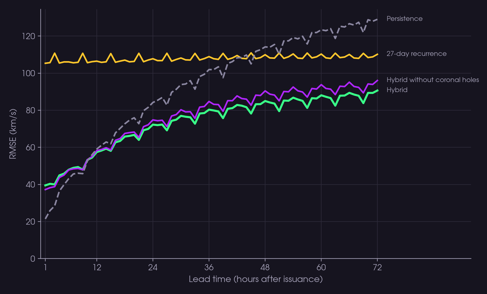

# Solar Wind Forecasting · FDL BenchLab 2026

Hourly forecasts of the solar-wind speed measured by ACE at L1, 1 to 72 hours ahead.
This is our entry to the
[FDL BenchLab Solar Wind Prediction Tournament 2026](overvie.md). Every 6 hours the
organizers run a stateless Docker container on CPU with a 15-minute limit; the official
metric is TIMSE.

The best model is a **gradient-boosting hybrid**: a single model for all 72 lead hours
that combines three sources of information, all cut off at `t0 − 1 h`:

- **L1 plasma (ACE):** latest speed and its age; 6, 24 and 72 h means; trend, density
  and temperature;
- **27-day recurrence:** speed one and two solar rotations before each target hour;
- **coronal holes (SDO/AIA 193 Å):** dark-area fraction in six 15° longitude strips, in
  images taken 0, 24 and 48 h earlier.



## Results

Test period: Jan 2024 – Oct 2026, 4,105 issuances every 6 h. This period was never used
for training or model selection.

| Model | RMSE (km/s) | RMSE at 72 h |
| --- | ---: | ---: |
| **Hybrid, tuned LightGBM** | **75.3** | **91** |
| Hybrid, XGBoost | 75.7 | — |
| Hybrid, scikit-learn HGB | 76.0 | — |
| Hybrid, tuned LightGBM, without coronal holes | 78.6 | 96 |
| Persistence | 97.8 | 129 |
| 27-day recurrence | 107.8 | 110 |

- Error is 23% below persistence overall and 30% below at 72 h.
- Persistence is better only during the first ~10 h.
- Coronal holes reduce RMSE by 3.4 km/s (95% CI 1.4–5.5) overall and by 5.5 km/s at 72 h.
- Five boosting libraries (scikit-learn, LightGBM, XGBoost, CatBoost and NGBoost) land
  within 2 km/s of each other.
- **A caveat on TIMSE:** pooled over the whole period, it rewards forecasts biased
  upwards. A constant 700 km/s scores a better TIMSE than any model. How the organizers
  aggregate TIMSE is still to be confirmed.

Details in [docs/hybrid.md](docs/hybrid.md). The results deck is
[docs/presentation/benchlab_results.pptx](docs/presentation/benchlab_results.pptx).

## Repository layout

```
src/benchlab_forecasting/  package: data, features, models, validation and TIMSE
  hybrid.py                hybrid model (experiment and tune)
  coronal_holes.py         coronal-hole mask and fractions from AIA images
  validation.py            metrics, TIMSE and block bootstrap
scripts/                   data download, feature building and figures
scripts/slurm/             SLURM jobs for training and hyperparameter search
tests/                     unit tests (unittest)
notebooks/                 exploration of the ACE data and AIA images
docs/                      documentation of each model and experiment (in Portuguese)
docs/presentation/         results deck, figures and the scripts that build them
overvie.md                 tournament summary, rules and plan (in Portuguese)
```

`data/` is not versioned (about 96 GB). Everything in it is rebuilt by the scripts below.

## Installation

Requires Python 3.11 or newer (the project uses 3.14, see `.python-version`) and
[uv](https://docs.astral.sh/uv/).

```bash
git clone git@github.com:AdrianoPereira/solar-wind-forecasting.git
cd solar-wind-forecasting
uv sync --locked --extra hybrid --extra boosting --group images --group notebooks
```

| Extra or group | Purpose |
| --- | --- |
| `--extra hybrid` | hybrid model with scikit-learn |
| `--extra boosting` | LightGBM, XGBoost, CatBoost and NGBoost |
| `--group images` | reading AIA FITS images (astropy) |
| `--group notebooks` | Jupyter, matplotlib and scipy (figures) |
| `--extra forecast` | Prophet |
| `--extra lstm` / `--extra hpo` | LSTM, GRU and Transformers on CPU (PyTorch); Optuna |

To add more extras later without removing installed packages, use
`uv sync --locked --inexact ...`.

## Running the hybrid model

Run every command from the repository root.

**1. Download the data** (ACE Level 2 and real-time, and AIA 193 Å every 6 h since 2011).
The download resumes where it stopped and takes hours:

```bash
mkdir -p data/download_logs
nohup bash scripts/download_training_data.sh > data/download_logs/latest.out 2>&1 &
```

Optional variables (`START_YEAR`, `END_DATE`, `AIA_JOBS`, `SKIP_AIA=1`…) are listed in
the script header. Individual downloads are described in
[scripts/README.md](scripts/README.md).

**2. Build the features:**

```bash
.venv/bin/python scripts/build_coronal_hole_features.py --workers 16   # data/features/coronal_holes_0193_6h.parquet
.venv/bin/python scripts/build_speed_series.py                          # speed series used by the figures
```

**3. Train and evaluate.** Each command trains the chosen variants, selects the number
of trees on validation (2022–2023) and scores the test period once:

```bash
export OMP_NUM_THREADS=16
# scikit-learn (default): MSE, MSE without coronal holes, and TIMSE-weighted variants
.venv/bin/python -m benchlab_forecasting.hybrid experiment \
  --variants mse mse_no_ch timse --output-dir data/experiments/hybrid_2011_2026
# another library: --model lightgbm | xgboost | catboost | ngboost
.venv/bin/python -m benchlab_forecasting.hybrid experiment --model xgboost \
  --variants mse mse_no_ch timse --output-dir data/experiments/hybrid_xgboost_2011_2026
```

Each experiment writes `report.json` (metrics and confidence intervals),
`test_predictions.parquet` and the fitted models (`model_*.pkl`).

**4. Hyperparameter search** (40 trials, resumable). It produces the tuned LightGBM in
`data/experiments/hybrid_lightgbm_tuning/`:

```bash
.venv/bin/python -m benchlab_forecasting.hybrid tune --model lightgbm --trials 40 --threads 32 \
  --output-dir data/experiments/hybrid_lightgbm_tuning
```

**5. Figures and deck:**

```bash
.venv/bin/python docs/presentation/make_figures.py   # deck figures, in docs/presentation/figures/
```

The `.pptx` is built by `docs/presentation/build.js` with `pptxgenjs`. To rebuild it:

1. Run `npm install` in `docs/presentation/`.
2. Run `node build.js`, with `PPTX_SKILL` pointing to a folder that contains
   `scripts/apply_theme.js`. That script applies the theme colors and is not part of
   this repository.

### On a SLURM cluster (SDumont)

Login nodes kill any process after 30 minutes of CPU time. Without `OMP_NUM_THREADS`,
the libraries open one thread per core and the process is killed. Run long training
jobs through SLURM, and set your account and partition in the `.sbatch` files.

```bash
mkdir -p data/slurm_logs
MODEL=catboost sbatch scripts/slurm/hybrid_experiment.sbatch   # VARIANTS, MAX_ITER and OUTPUT_DIR are optional
sbatch scripts/slurm/tune_lightgbm.sbatch
```

## Tests

```bash
OMP_NUM_THREADS=2 PYTHONPATH=src .venv/bin/python -m unittest discover -s tests
```

Some tests need the optional extras (`boosting`, `lstm`, `forecast`); the rest run with
`hybrid` alone.

## Other models

Before the hybrid we tried Prophet, LSTM, GRU, attention models and Transformers.
Documentation for each (in Portuguese):

- [Prophet and baselines](docs/forecasting.md), [Prophet tuning](docs/tuning.md) and
  [Prophet on complete windows](docs/prophet_complete_windows.md); CLI `benchlab-forecast`
  (`uv sync --locked --extra forecast`).
- [LSTM](docs/lstm.md), [GRU](docs/gru.md), [GRU with attention](docs/attention_gru.md),
  [GRU with attention tuning](docs/attention_gru_tuning.md) and
  [LSTM with attention, Transformer and Patch Transformer](docs/attention_models.md).
- [Temporal validation](docs/validation.md), [TIMSE with figures](docs/timse.md) and
  [result plots](docs/plotting.md).

## Tournament submission

The official starter kit (`benchlab-starter-kit/`) is a separate repository from the
organizers and is kept out of this one. It holds the team token in `.team`, which must
never be committed. Clone the kit next to this project, following the organizers'
instructions.

The submission container for the hybrid model is still being prepared.
