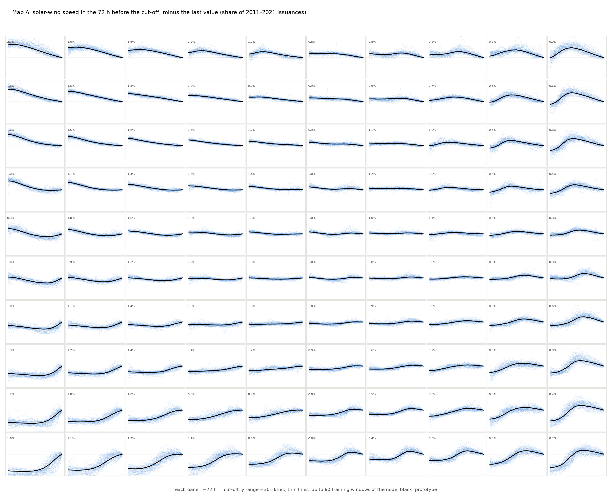
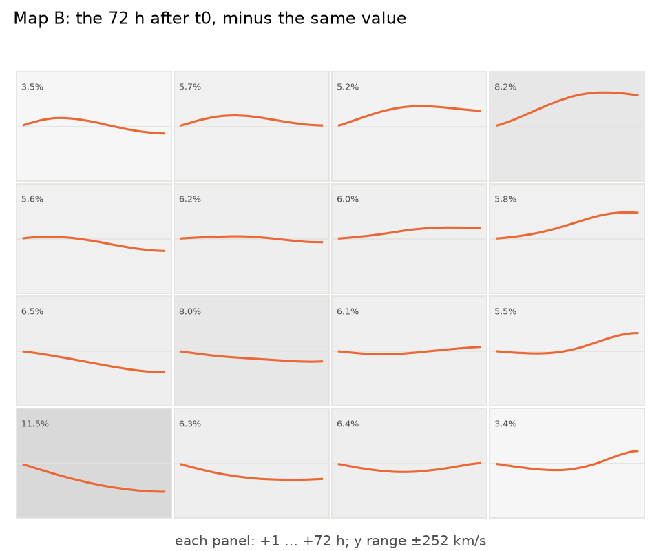
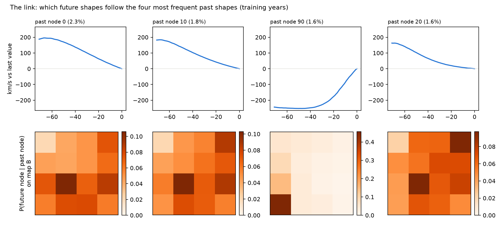
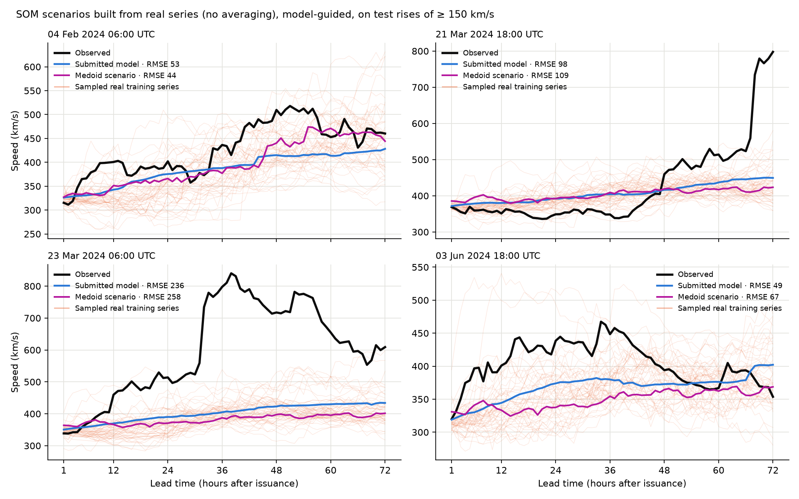

# Pós-processamento com dois SOMs ligados

Experimento de 04/11/2026. O objetivo era usar padrões das séries de vento solar para
recuperar picos e variações características que o modelo suaviza. **Conclusão: não
melhora a previsão submetida.** O código fica disponível para retomar a ideia com outras
entradas. A submissão não foi alterada.

## A ideia

1. **Mapa A (passado):** um SOM aprende as formas da velocidade nas 72 h até o corte
   `t0 − 1 h`, a mesma janela de L1 do modelo de ML, menos o último valor. Assim ele agrupa
   pela forma (subindo, caindo, estável, pico recente), não pelo nível.
2. **Mapa B (futuro):** outro SOM aprende as formas das 72 h depois de `t0`, menos o mesmo
   valor.
3. **Ligação:** contando no treino (2011–2021) quantas emissões caem no nó i de A e no nó
   j de B, obtém-se `P(j | i)`. A contagem é suavizada pela vizinhança do mapa A e recebe
   uma priori marginal.
4. **Pós-processamento guiado pelo modelo.** O modelo, que vê os buracos coronais, escolhe
   o cenário, e o mapa dá a forma:

   ```
   w_j ∝ P(j | i) · exp(−d_j² / 2σ²)        d_j = distância RMS entre a previsão e o protótipo j
   final(h) = α(h) · previsão(h) + (1 − α(h)) · (último valor + Σ_j w_j · protótipo_j(h))
   ```

   `α(h)` varia linearmente de 1 h a 72 h.
5. **Seleção e teste:** os tamanhos dos mapas, σ e α foram escolhidos pelo RMSE na
   validação 2022–2023. O teste, de jan/2024 a out/2026, foi avaliado uma vez, contra a
   previsão submetida (LightGBM ajustado + persistência).

Foram comparadas três variantes:

- **SOM sozinho:** `Σ P(j|i)·protótipo`, a ideia original, sem o modelo;
- **modelo + análogo:** uma média ponderada dos dois, com α escolhido na validação;
- **SOM guiado pelo modelo:** a fórmula acima.

Também foi testada uma versão em que o mapa A recebe, além do passado, **a recorrência das
próximas 72 h**: a velocidade de 27 dias antes de cada hora-alvo, que já é conhecida em
`t0` e carrega o horário das correntes recorrentes.

```bash
.venv/bin/python -m benchlab_forecasting.som experiment --output-dir data/experiments/som_2011_2026
.venv/bin/python -m benchlab_forecasting.som experiment --with-recurrence \
  --output-dir data/experiments/som_recurrence_2011_2026
.venv/bin/python scripts/plot_som.py --experiment data/experiments/som_2011_2026
```

Cada execução leva menos de um minuto em CPU. O SOM é um *batch SOM* determinístico, escrito
em numpy em `src/benchlab_forecasting/som.py`; os testes estão em `tests/test_som.py`.

## Os mapas

Em cada painel, a linha preta é o protótipo do neurônio. As linhas finas e transparentes
são até 60 janelas de treino (sorteadas) que caem nele, e o percentual é a fração das
emissões de 2011–2021 no neurônio. Para gerar sem as janelas, use `--no-members` no
`scripts/plot_som.py`.







- **Mapa A (10×10):**
  - separa bem quedas longas, platôs, subidas recentes e picos que já passaram;
  - erro de quantização de 26 km/s;
  - erro topográfico de 5,6%.
- **Mapa B:** a validação preferiu 4×4. Os cenários são suaves: subir, descer, estável e
  subir tarde. Mapas maiores (6×6, 8×8) têm protótipos mais nítidos, mas pioram o RMSE de
  validação.
- **O espalhamento conta a história:**
  - No mapa A, as janelas ficam justas em torno de cada protótipo.
  - No mapa B, os futuros de um mesmo neurônio se espalham muito mais. No cenário "subir"
    (8,2% das emissões), as séries vão de quase nada até +300 km/s, com a subida em
    horários diferentes.
  - É a mesma conclusão da informação mútua: o passado não fixa a forma do futuro.
- **Ligação:**
  - depois de uma subida forte (nó 90 de A), 45% da probabilidade vai para "descer" (o
    fim de uma corrente rápida);
  - depois de quedas, `P(j|i)` fica espalhado, com no máximo ~10% por cenário.

## Resultados no teste (4.105 emissões, 2024-01 a 2026-10)

| Previsão | RMSE | 1–24 h | 49–72 h | Ganho vs base (IC 95%, blocos de 27 dias) |
| --- | ---: | ---: | ---: | --- |
| Base: submissão | 74,42 | 53,66 | 87,01 | — |
| SOM sozinho, `Σ P(j\|i)·protótipo` | 78,22 | 54,66 | 92,73 | −3,80 [−6,10; −1,74] |
| Modelo + análogo | 74,40 | 53,61 | 87,01 | +0,02 [−0,05; +0,09] |
| **SOM guiado pelo modelo** | 74,39 | 53,53 | 87,04 | +0,03 [−0,07; +0,14] |
| SOM guiado, mapa A com recorrência | 74,39 | 53,53 | 87,04 | +0,03 [−0,07; +0,14] |
| SOM sozinho, mapa A com recorrência | 76,76 | 54,19 | 90,58 | −2,34 [−4,38; −0,56] |

Nas 218 emissões de teste em que o vento sobe pelo menos 100 km/s em 72 h:

| Previsão | RMSE | Viés da altura do pico | Erro do horário do pico |
| --- | ---: | ---: | ---: |
| Base | 103,4 | −134 km/s | 23,2 h |
| SOM guiado | 102,8 | −136 km/s | 22,9 h |
| SOM sozinho | 109,9 | −171 km/s | 25,6 h |

## Por que não funcionou

- **O passado do vento diz pouco sobre a forma do futuro.**
  - A informação mútua entre os nós de A e de B, descontada a de pares embaralhados (o
    estimador direto é inflado com poucas amostras por célula), explica só **~6%** da
    entropia da forma futura.
  - Com a recorrência no mapa A, sobe para **12–14%**.
  - As subidas vêm de buracos coronais e de CMEs, que não aparecem na série passada.
- **O que o mapa sabe, o modelo já usa.** O LightGBM vê a mesma janela de L1 e a mesma
  recorrência, então o pós-processamento quase não tem o que corrigir. A validação escolhe
  α alto (0,4 → 0,8) e um mapa B pequeno, e o resultado fica a menos de 0,1 km/s da base.
- **Picos não voltam com médias.**
  - Mesmo os protótipos do mapa B são médias de trajetórias com o pico em horários
    diferentes, por isso são suaves.
  - Escolher protótipos mais nítidos aumenta o erro quando o horário erra: o pico fora do
    lugar é punido duas vezes.
  - O viés de −134 km/s na altura dos picos é limitação de qualquer previsão que minimiza
    erro quadrático sem saber o horário da subida.
- **No caso extremo** (11/05/2024, a supertempestade de CMEs), o SOM aproxima mais a
  previsão do observado: RMSE de 130 contra 155 da base. Mas é um evento transiente; no
  conjunto, o efeito se anula.

## Cenários sem média: medoides e séries reais sorteadas

Os protótipos são médias, e o cenário era uma média ponderada de protótipos. Médias de
trajetórias com o pico em horários diferentes viram rampas, então a versão acima não
tinha como devolver picos. Este segundo experimento, de 04/11/2026, usa os mesmos mapas,
a mesma ligação e o mesmo σ, mas monta o cenário só com **séries reais do treino**:

- **Medoide:** a série de treino mais próxima do protótipo, no neurônio mais provável. O
  neurônio é escolhido de duas formas: por `w_j` (guiado pelo modelo) ou só por
  `P(j|i)`. O cenário é usado puro (α = 0) ou misturado ao modelo, com α escolhido na
  validação.
- **Sorteio:** 50 séries reais por emissão. Primeiro se sorteia o neurônio com
  probabilidade `w_j`, depois um membro dele. O resultado é um conjunto de trajetórias
  reais, avaliado por CRPS e membro a membro.

```bash
.venv/bin/python -m benchlab_forecasting.som sharp --source data/experiments/som_2011_2026 \
  --output-dir data/experiments/som_sharp_2011_2026
.venv/bin/python scripts/plot_som_sharp.py --experiment data/experiments/som_sharp_2011_2026
```

**Previsões únicas.** Teste 2024–2026; "subidas" são as 218 emissões em que o vento sobe
pelo menos 100 km/s em 72 h.

| Previsão | RMSE | Ganho vs base (IC 95%) | Viés do pico nas subidas | Erro do horário do pico | TIMSE mediano por emissão |
| --- | ---: | --- | ---: | ---: | ---: |
| Base: submissão | 74,4 | — | −134 km/s | 23,2 h | 326 mil |
| Medoide, guiado pelo modelo, α = 0 | 75,2 | −0,83 [−1,42; −0,32] | −129 km/s | **19,9 h** | 341 mil |
| Medoide, guiado, α na validação (0,8 → 0,9) | 74,4 | +0,03 [−0,03; +0,10] | −135 km/s | 22,8 h | 326 mil |
| Medoide, só `P(j\|i)`, α = 0 | 91,8 | −17,4 [−24,5; −9,9] | −79 km/s | 27,5 h | 550 mil |

**Conjuntos de 50 séries por emissão.** A coluna "membros" traz as métricas de um membro
qualquer, em média.

| Conjunto | CRPS | RMSE da média | RMSE dos membros | Viés do pico (membros) | Erro do horário (membros) |
| --- | ---: | ---: | ---: | ---: | ---: |
| Séries reais, guiado pelo modelo | 47,6 | 74,9 | 77,4 | −94 km/s | 23,2 h |
| Séries reais, só `P(j\|i)` | 49,0 | 78,3 | 91,3 | −100 km/s | 28,0 h |
| **Referência justa:** modelo + trajetórias de erro reais da validação | **38,2** | — | 99,9 | −69 km/s | 23,2 h |

A previsão única do modelo tem CRPS igual ao seu MAE (50,8). Qualquer conjunto com alguma
dispersão ganha dela, por isso a comparação justa é com a referência acima: a previsão do
modelo somada a 50 trajetórias de erro sorteadas entre as 2.529 emissões completas de
2022–2023.



**Leitura:**

- **Sem média, os picos ficam mais altos, mas o erro cresce.** O medoide puro reduz pouco o
  viés do pico (−134 → −129 km/s) e piora o RMSE em 0,8 km/s. As séries sorteadas chegam a
  −94 km/s de viés, mas cada uma tem RMSE de 77 km/s.
- **O único sinal novo é o horário.** O medoide guiado pelo modelo erra o horário do pico
  em 19,9 h, contra 23,2 h da base. Esse ganho de ~3 h não teve intervalo de confiança
  calculado e vem junto com um RMSE pior.
- **Como conjunto probabilístico, o SOM perde para o simples:** CRPS de 47,6 contra 38,2 do
  modelo com erros reais. Os cenários do SOM ficam presos perto da previsão do modelo e não
  cobrem as subidas fortes. No caso de 23/03/2024, nenhuma das 50 séries chega perto do
  observado.
- **Com recorrência no mapa A** (`som_sharp_recurrence_2011_2026`), os resultados são
  praticamente iguais.

## Retomada: buracos coronais e nível no mapa A

Também em 04/11/2026. O mapa A passou a receber mais blocos, além da forma das 72 h:

- **Buracos coronais:** as frações das imagens de 0, 24 e 48 h, com 2 limiares × 6 faixas
  de longitude × 3 imagens (36 valores), padronizadas.
- **Nível:** o último valor da velocidade, padronizado.

Cada bloco é escalado para ter, com peso 1, a mesma variância total da forma do vento. Os
pesos (0,5, 1 ou 2) foram escolhidos na validação, junto com os tamanhos dos mapas, σ e α.
A imagem ausente conta como média.

```bash
.venv/bin/python -m benchlab_forecasting.som experiment --with-coronal-holes --output-dir data/experiments/som_ch_2011_2026
.venv/bin/python -m benchlab_forecasting.som experiment --with-level --output-dir data/experiments/som_level_2011_2026
.venv/bin/python -m benchlab_forecasting.som experiment --with-level --with-coronal-holes \
  --output-dir data/experiments/som_level_ch_2011_2026
.venv/bin/python -m benchlab_forecasting.som sharp --source data/experiments/som_level_ch_2011_2026 \
  --output-dir data/experiments/som_sharp_level_ch_2011_2026
```

| Mapa A | Informação mútua (treino / teste) | RMSE, SOM guiado | Ganho vs base (IC 95%) | RMSE, SOM sozinho |
| --- | --- | ---: | --- | ---: |
| Forma (o original) | 5,6% / 5,9% | 74,39 | +0,03 [−0,07; +0,14] | 78,2 |
| Forma + buracos coronais | 6,1% / 9,1% | 74,40 | +0,02 [−0,08; +0,14] | 78,4 |
| Forma + buracos + recorrência | 8,5% / 4,7% | 74,48 | −0,07 [−0,28; +0,14] | 77,5 |
| Forma + nível | **11,5% / 10,4%** | 74,39 | +0,02 [−0,07; +0,13] | **77,2** |
| Forma + nível + buracos | 7,8% / 3,6% | 74,42 | 0,00 [−0,19; +0,19] | 77,2 |

A informação mútua é medida como fração da entropia da forma futura, já descontada a de
pares embaralhados. A base, a previsão submetida, tem RMSE de 74,42.

**Cenários de séries reais com nível + buracos coronais:**

- O medoide puro piora tudo: RMSE de 93,3 e erro de horário do pico de 27,5 h, contra
  23,2 h da base.
- Com α escolhido na validação, o resultado é igual à base.
- O conjunto sorteado tem CRPS de 48,7, contra 38,2 da referência (modelo + erros reais).

### Diagnóstico: onde está a informação

Para separar "o SOM não aproveita" de "a informação não existe", foi usada uma regressão
linear com *ridge*, treinada em 2011–2021. O alvo é a variação média do vento em 49–72 h
em relação ao último valor, e o R² foi medido na validação 2022–2023:

| Entradas | R² |
| --- | ---: |
| Só o nível (último valor) | 0,350 |
| Forma das 72 h + nível | 0,344 |
| Buracos coronais + nível | 0,412 |
| Forma + recorrência + nível | 0,369 |
| Forma + recorrência + buracos + nível | **0,423** |

- **O nível é o que mais prevê a variação.** Vento rápido tende a desacelerar e vento lento
  a acelerar. A versão original do mapa A subtraía o último valor e, por isso, não via essa
  variável. Com o nível, a informação mútua dobra e o SOM sozinho melhora 1 km/s.
- **A forma das 72 h não acrescenta nada** além do nível.
- **Os buracos coronais acrescentam ~6 pontos de R², e a recorrência ~2.** É informação
  real, mas pequena. É coerente com o ganho de 3,4 km/s dos buracos coronais no próprio
  híbrido.
- **Misturados à forma num mapa só,** os 36 valores de buraco coronal diluem as distâncias:
  a informação mútua cai quando eles entram junto com o nível.

**Conclusão:** o LightGBM já usa todas essas entradas, e melhor. O erro que sobra depois
dele não depende de regime de um jeito que um SOM consiga capturar. Em todas as versões, o
pós-processamento fica a menos de 0,1 km/s da previsão submetida, com intervalos de
confiança que contêm zero.

## Se for retomar

- **Entradas que carreguem o horário das subidas.** Buracos coronais e nível já foram
  testados (acima), sem ganho. O que resta é a previsão física proposta em
  [physics_informed_model.md](physics_informed_model.md), que propaga os buracos até L1
  e daria o horário de chegada de forma explícita.
- **Objetivo:** se o que importa são picos e eventos (TIMSE por emissão, acerto de
  subidas), escolher σ e α por essas métricas e não pelo RMSE. Os cenários também podem ser
  usados como conjunto probabilístico, avaliado por CRPS.
- **Usar o mapa como feature:** passar a posição no mapa A ou `P(j|i)` como entrada do
  LightGBM, em vez de pós-processar.
